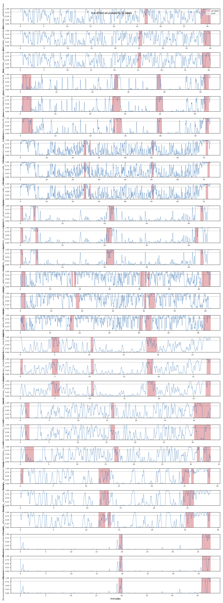

# Ad detector evaluation

- leave-one-episode-out, 9 episodes
- tolerance: both boundaries within 5 s
- interval precision 0.024, recall 0.058, F1 0.034 (micro)
- macro precision 0.061, recall 0.074
- post-processing: smooth 6.0 s, threshold 0.80, min duration 30.0 s

| episode | gold | pred | tp | fp | fn | P | R |
|---|---|---|---|---|---|---|---|
| 99-invisible__perfectly-leveraged-for-the-sq | 6 | 47 | 0 | 47 | 6 | 0.00 | 0.00 |
| dan-snow-s-history-hit__how-rasputin-destroy | 13 | 19 | 0 | 19 | 13 | 0.00 | 0.00 |
| freakonomics-radio__694-does-democracy-reall | 12 | 34 | 0 | 34 | 12 | 0.00 | 0.00 |
| hard-fork__jensen-huang-is-out-at-nvidia | 12 | 15 | 4 | 11 | 8 | 0.27 | 0.33 |
| odd-lots__what-nvidia-s-megaspeed-scandal-is | 19 | 48 | 0 | 48 | 19 | 0.00 | 0.00 |
| planet-money__how-bodegas-led-to-the-yemeni- | 12 | 20 | 0 | 20 | 12 | 0.00 | 0.00 |
| revisionist-history__from-the-big-dig-mitt-t | 10 | 39 | 0 | 39 | 10 | 0.00 | 0.00 |
| the-daily__what-jensen-huang-s-resignation-w | 13 | 21 | 0 | 21 | 13 | 0.00 | 0.00 |
| the-economics-show-with-soumaya-keynes__can- | 6 | 7 | 2 | 5 | 4 | 0.29 | 0.33 |

